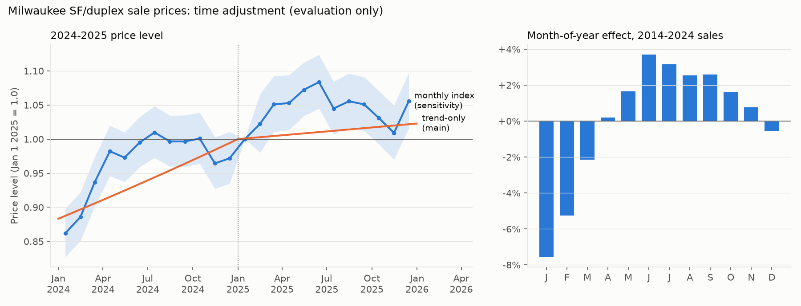

# Stage 3: assessor ratio study (generated by src/avm/stage3_assessor.py)

Ratio = roll Y assessed value / sale price at the Jan 1 Y trend level, neutral season (trend-only adjustment; evaluation only). Cells: estimate [95% bootstrap CI, 2,000 resamples, seed fixed]; ' x' = misses the IAAO target. **PRD and PRB against sale prices are biased toward showing regressivity** (sale-price noise sits in the denominator).

## Time adjustment
2025 trend: slope 0.0103/month before Jan 1 2025, 0.0019/month after (se 0.0009); n = 8418. IAAO ratio trend implies 0.17%/month.

Month-of-year effects (2014-2024):

| month | log_effect | pct |
|---|---|---|
| 1 | -0.07859 | -0.0756 |
| 2 | -0.05408 | -0.0526 |
| 3 | -0.02157 | -0.0213 |
| 4 | 0.001865 | 0.0019 |
| 5 | 0.01638 | 0.0165 |
| 6 | 0.03628 | 0.0369 |
| 7 | 0.03119 | 0.0317 |
| 8 | 0.0252 | 0.0255 |
| 9 | 0.02547 | 0.0258 |
| 10 | 0.01613 | 0.0163 |
| 11 | 0.007531 | 0.0076 |
| 12 | -0.005803 | -0.0058 |

## 2025 assessor metrics vs IAAO targets

| trim | stratum | n | median_ratio | cod | prd | prb | mki |
|---|---|---|---|---|---|---|---|
| IAAO trimmed | all | 4215 | 0.892 [0.885, 0.899] x | 17.6 [17.1, 18.1] x | 1.009 [1.006, 1.012] | 0.036 [0.024, 0.048] | 0.984 [0.969, 0.999] |
| IAAO trimmed | duplex | 1236 | 0.887 [0.873, 0.899] x | 19.2 [18.2, 20.2] x | 1.006 [1.000, 1.013] | 0.039 [0.020, 0.059] | 1.007 [0.982, 1.031] |
| IAAO trimmed | single-family | 2979 | 0.895 [0.887, 0.902] x | 16.9 [16.4, 17.5] x | 1.011 [1.007, 1.014] | 0.033 [0.017, 0.049] | 0.967 [0.950, 0.986] |
| untrimmed | all | 4229 | 0.892 [0.886, 0.899] x | 18.0 [17.4, 18.5] x | 1.012 [1.009, 1.016] | 0.026 [0.012, 0.040] | 0.980 [0.964, 0.994] |
| untrimmed | duplex | 1242 | 0.887 [0.874, 0.899] x | 19.7 [18.6, 20.7] x | 1.011 [1.003, 1.019] | 0.028 [0.006, 0.050] | 1.004 [0.978, 1.027] |
| untrimmed | single-family | 2987 | 0.895 [0.886, 0.902] x | 17.2 [16.6, 17.8] x | 1.013 [1.009, 1.017] | 0.024 [0.006, 0.040] | 0.963 [0.944, 0.982] |

## IAAO 3x IQR trim log: 14 of 4229 sales (full list in iaao_trim_log_2025.csv)

| sale_id | sale_date | sale_price | adj_price | bench_assessed_total | ratio | land_use_y1 |
|---|---|---|---|---|---|---|
| 2025-00637 | 2025-09-04 00:00:00 | 1.2e+05 | 1.152e+05 | 2.003e+05 | 1.738 | 8810 |
| 2025-03599 | 2025-10-22 00:00:00 | 9.2e+04 | 8.89e+04 | 1.553e+05 | 1.747 | 8810 |
| 2025-04053 | 2025-12-01 00:00:00 | 3.5e+05 | 3.448e+05 | 6.062e+05 | 1.758 | 8820 |
| 2025-02789 | 2025-10-10 00:00:00 | 5e+04 | 4.835e+04 | 8.52e+04 | 1.762 | 8820 |
| 2025-01001 | 2025-01-10 00:00:00 | 9e+04 | 9.73e+04 | 1.728e+05 | 1.776 | 8810 |
| 2025-01883 | 2025-09-03 00:00:00 | 7e+04 | 6.721e+04 | 1.226e+05 | 1.824 | 8820 |
| 2025-01927 | 2025-11-07 00:00:00 | 3.8e+04 | 3.7e+04 | 6.95e+04 | 1.878 | 8820 |
| 2025-01669 | 2025-07-07 00:00:00 | 5e+04 | 4.791e+04 | 9.06e+04 | 1.891 | 8810 |
| 2025-02841 | 2025-11-13 00:00:00 | 5e+04 | 4.866e+04 | 9.61e+04 | 1.975 | 8820 |
| 2025-00786 | 2025-07-03 00:00:00 | 9.725e+04 | 9.32e+04 | 1.883e+05 | 2.02 | 8810 |
| 2025-02010 | 2025-12-16 00:00:00 | 7e+04 | 6.89e+04 | 1.422e+05 | 2.064 | 8810 |
| 2025-03335 | 2025-11-03 00:00:00 | 4.79e+04 | 4.665e+04 | 1.066e+05 | 2.285 | 8810 |
| 2025-01929 | 2025-08-02 00:00:00 | 3e+04 | 2.887e+04 | 8.17e+04 | 2.83 | 8810 |
| 2025-01733 | 2025-12-18 00:00:00 | 3.5e+04 | 3.445e+04 | 1.046e+05 | 3.037 | 8820 |

## Sensitivity: time adjustment (IAAO trimmed)

| adjustment | n | median_ratio | cod | prd | prb | mki |
|---|---|---|---|---|---|---|
| IAAO ratio trend | 4215 | 0.886 [0.878, 0.893] x | 17.3 [16.8, 17.8] x | 1.008 [1.005, 1.012] | 0.036 [0.025, 0.048] | 0.986 [0.971, 1.001] |
| seasonal monthly index | 4215 | 0.917 [0.910, 0.923] | 17.5 [17.1, 18.0] x | 1.009 [1.006, 1.012] | 0.036 [0.025, 0.047] | 0.985 [0.970, 1.001] |
| trend-only by tercile | 4215 | 0.885 [0.880, 0.892] x | 17.6 [17.2, 18.1] x | 1.008 [1.005, 1.011] | 0.040 [0.029, 0.052] | 0.989 [0.974, 1.004] |
| trend-only, season kept | 4215 | 0.887 [0.879, 0.894] x | 17.5 [17.0, 18.0] x | 1.009 [1.006, 1.012] | 0.036 [0.024, 0.047] | 0.983 [0.968, 0.998] |
| trend-only, season removed (main) | 4215 | 0.892 [0.885, 0.899] x | 17.6 [17.1, 18.1] x | 1.009 [1.006, 1.012] | 0.036 [0.024, 0.048] | 0.984 [0.969, 0.999] |
| unadjusted | 4215 | 0.876 [0.870, 0.883] x | 17.5 [17.0, 18.0] x | 1.009 [1.006, 1.012] | 0.035 [0.024, 0.047] | 0.983 [0.968, 0.998] |

## Before vs after the assessment notice date (IAAO trimmed)

| period | n | median_ratio | cod | prd | prb | mki |
|---|---|---|---|---|---|---|
| sold before 2025-04-01 | 798 | 0.852 [0.836, 0.867] x | 17.2 [16.2, 18.2] x | 1.009 [1.002, 1.016] | 0.036 [0.012, 0.061] | 0.980 [0.948, 1.011] |
| sold on/after 2025-04-01 | 3417 | 0.901 [0.893, 0.908] | 17.6 [17.1, 18.1] x | 1.009 [1.005, 1.013] | 0.036 [0.022, 0.050] | 0.986 [0.968, 1.002] |

## Context: each sale year vs its own roll (IAAO trimmed, own trend)

| sale_year | n | median_ratio | cod | prd | prb | mki | n_trimmed |
|---|---|---|---|---|---|---|---|
| 2014 | 2032 | 0.993 [0.983, 1.002] | 13.9 [13.4, 14.5] | 1.039 [1.034, 1.043] x | -0.085 [-0.099, -0.073] x | 0.847 [0.830, 0.863] x | 25 |
| 2015 | 2577 | 0.968 [0.960, 0.975] | 14.0 [13.5, 14.5] | 1.035 [1.030, 1.040] x | -0.067 [-0.079, -0.055] x | 0.887 [0.871, 0.904] x | 61 |
| 2016 | 3173 | 0.991 [0.984, 0.996] | 13.4 [12.9, 13.8] | 1.032 [1.028, 1.037] x | -0.071 [-0.082, -0.059] x | 0.883 [0.867, 0.898] x | 49 |
| 2017 | 3531 | 0.952 [0.947, 0.958] | 13.1 [12.7, 13.5] | 1.024 [1.020, 1.027] | -0.040 [-0.049, -0.030] | 0.921 [0.909, 0.933] x | 55 |
| 2018 | 3982 | 0.920 [0.917, 0.926] | 13.9 [13.5, 14.2] | 1.016 [1.013, 1.020] | -0.020 [-0.030, -0.010] | 0.956 [0.944, 0.969] | 59 |
| 2019 | 4332 | 0.875 [0.869, 0.879] x | 17.4 [16.9, 18.0] x | 1.026 [1.021, 1.030] | -0.025 [-0.037, -0.014] | 0.946 [0.932, 0.961] x | 126 |
| 2020 | 4998 | 0.999 [0.994, 1.005] | 13.8 [13.5, 14.2] | 1.004 [1.001, 1.007] | 0.014 [0.007, 0.022] | 1.001 [0.990, 1.011] | 11 |
| 2021 | 4957 | 0.815 [0.809, 0.821] x | 19.0 [18.5, 19.4] x | 1.003 [0.999, 1.007] | 0.051 [0.040, 0.062] x | 1.014 [0.999, 1.028] | 17 |
| 2022 | 5432 | 0.815 [0.811, 0.820] x | 17.8 [17.4, 18.3] x | 1.017 [1.014, 1.021] | 0.009 [-0.001, 0.019] | 0.948 [0.935, 0.962] x | 29 |
| 2023 | 4310 | 0.768 [0.762, 0.773] x | 19.7 [19.2, 20.3] x | 1.021 [1.016, 1.027] | 0.002 [-0.011, 0.015] | 0.956 [0.937, 0.975] | 32 |
| 2024 | 4200 | 0.882 [0.876, 0.888] x | 18.7 [18.2, 19.2] x | 1.010 [1.005, 1.015] | 0.045 [0.032, 0.058] | 0.984 [0.964, 1.002] | 15 |
| 2025 | 4215 | 0.892 [0.885, 0.899] x | 17.6 [17.1, 18.1] x | 1.009 [1.006, 1.012] | 0.036 [0.024, 0.048] | 0.984 [0.969, 0.999] | 14 |

## 2019 outliers: 120 sales

| diagnosis | n |
|---|---|
| mixed / moderate | 69 |
| price < 50% of both 2018 and 2020 rolls (price anomaly) | 49 |
| price > 2x both 2018 and 2020 rolls (price anomaly) | 2 |

### Price vs prior roll (Y-1), all clean sales by year

| sale_year | n | price_lt_50pct_prior_roll | price_lt_33pct_prior_roll | price_gt_2x_prior_roll |
|---|---|---|---|---|
| 2014 | 2057 | 0.0112 | 0.0015 | 0.0019 |
| 2015 | 2638 | 0.0152 | 0.0038 | 0.0049 |
| 2016 | 3224 | 0.0059 | 0.0006 | 0.009 |
| 2017 | 3590 | 0.0033 | 0.0006 | 0.0109 |
| 2018 | 4047 | 0.003 | 0.0002 | 0.0153 |
| 2019 | 4461 | 0.0137 | 0.0034 | 0.0399 |
| 2020 | 5011 | 0.0008 | 0 | 0.0579 |
| 2021 | 4977 | 0.001 | 0.0002 | 0.0952 |
| 2022 | 5464 | 0.0002 | 0 | 0.1433 |
| 2023 | 4347 | 0.0023 | 0.0002 | 0.0922 |
| 2024 | 4222 | 0.0007 | 0.0002 | 0.1376 |
| 2025 | 4232 | 0.0005 | 0 | 0.0907 |
