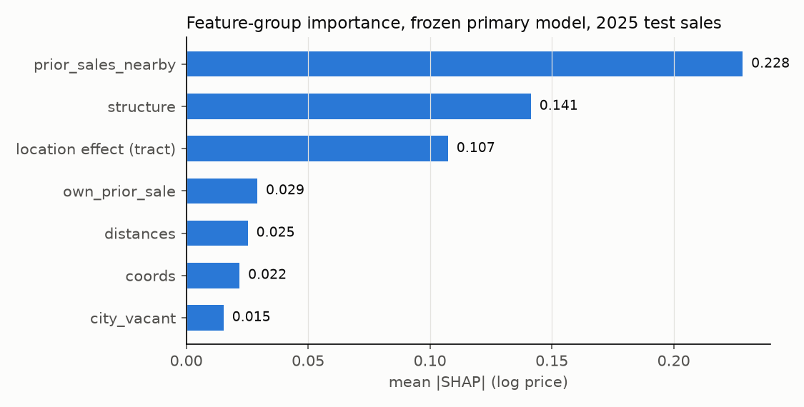
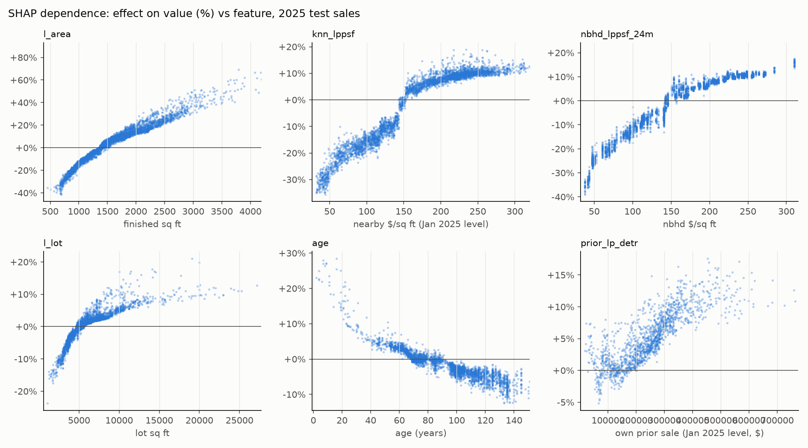

# Stage 7: explainability (generated by src/avm/stage7_explain.py)

Frozen primary model (public data only), refit through 2024 and verified against its frozen 2025 predictions. SHAP in log price (TreeSHAP). Group importance first: coordinates, distances and nearby-sales features are correlated and split credit.

## Feature-group importance

| group | mean_abs_shap | share |
|---|---|---|
| prior_sales_nearby | 0.2283 | 0.4015 |
| structure | 0.1414 | 0.2487 |
| location effect (tract) | 0.1074 | 0.1889 |
| own_prior_sale | 0.0291 | 0.0513 |
| distances | 0.0252 | 0.0444 |
| coords | 0.0218 | 0.0384 |
| city_vacant | 0.0153 | 0.0269 |

## Top features

| feature | mean_abs_shap |
|---|---|
| l_area | 0.14 |
| knn_lppsf | 0.1261 |
| nbhd_lppsf_24m | 0.1104 |
| loc | 0.1074 |
| style | 0.0434 |
| l_lot | 0.0306 |
| age | 0.0295 |
| prior_lp_detr | 0.0244 |
| full_baths | 0.0212 |
| y_m | 0.0175 |
| d_lake_m | 0.0148 |
| n_city_200m | 0.0128 |
| x_m | 0.0103 |
| baths_missing | 0.0098 |
| d_transit_m | 0.0084 |

## Dependence plots (top 6 numeric features)

## Sanity checks (Spearman of feature value vs its SHAP; |rho| > 0.1 in the expected direction)

| feature | expected | spearman_value_vs_shap | mean_abs_shap | verdict |
|---|---|---|---|---|
| l_area | + | 0.992 | 0.14 | as expected |
| l_lot | + | 0.966 | 0.0306 | as expected |
| full_baths | + | 0.773 | 0.0212 | as expected |
| half_baths | + | 0.726 | 0.0047 | as expected |
| age | - | -0.923 | 0.0295 | as expected |
| beds | none | -0.088 | 0.0053 | n/a |
| stories_num | none | -0.223 | 0.002 | n/a |
| d_lake_m | - | -0.305 | 0.0148 | as expected |
| d_downtown_m | none | -0.849 | 0.0076 | n/a |
| d_major_road_m | + | 0.087 | 0.0059 | CHECK |
| d_transit_m | none | 0.658 | 0.0084 | n/a |
| d_park_m | - | -0.263 | 0.0052 | as expected |
| knn_lppsf | + | 0.961 | 0.1261 | as expected |
| nbhd_lppsf_24m | + | 0.979 | 0.1104 | as expected |
| knn_dist_m | none | -0.662 | 0.0078 | n/a |
| prior_lp_detr | + | 0.851 | 0.0244 | as expected |
| months_since_prior | none | -0.951 | 0.0068 | n/a |
| has_prior_sale | none | 0.799 | 0.0001 | n/a |
| n_city_200m | - | -0.622 | 0.0128 | as expected |
| n_vacant_200m | - | -0.434 | 0.0042 | as expected |
| x_m | none | 0.222 | 0.0103 | n/a |
| y_m | none | -0.844 | 0.0175 | n/a |

## Comparable sales on 2025 (coverage: {'test_sales': 4197, 'with_comps': 4197})

Comp value (a) = median of comps moved to the Jan 1 2025 trend level, no model adjustment; (b) = model-adjusted (circular: the model adjusts its own check). Diffs vs the model, paired bootstrap.

| statistic | method | n | value | diff vs model |
|---|---|---|---|---|
| median_ratio | assessor | 4197 | 0.8937 [0.8874, 0.9002] | -0.1032 [-0.1093, -0.0973] |
| median_ratio | model | 4197 | 0.9969 [0.9912, 1.0029] |  |
| median_ratio | comps (a) time-adjusted | 4197 | 0.9904 [0.9827, 0.9991] | -0.0065 [-0.0142, +0.0009] |
| median_ratio | comps (b) model-adjusted | 4197 | 0.9880 [0.9812, 0.9948] | -0.0089 [-0.0135, -0.0049] |
| cod | assessor | 4197 | 17.7553 [17.2272, 18.2837] | +1.2306 [+0.7205, +1.7218] |
| cod | model | 4197 | 16.5247 [16.0340, 17.0545] |  |
| cod | comps (a) time-adjusted | 4197 | 20.8401 [20.1521, 21.5765] | +4.3154 [+3.6932, +4.8811] |
| cod | comps (b) model-adjusted | 4197 | 17.4112 [16.8844, 17.9665] | +0.8865 [+0.6351, +1.1369] |
| prb | assessor | 4197 | 0.0216 [0.0085, 0.0346] | +0.0474 [+0.0368, +0.0587] |
| prb | model | 4197 | -0.0258 [-0.0410, -0.0104] |  |
| prb | comps (a) time-adjusted | 4197 | -0.1221 [-0.1437, -0.1010] | -0.0963 [-0.1102, -0.0821] |
| prb | comps (b) model-adjusted | 4197 | -0.0567 [-0.0721, -0.0405] | -0.0308 [-0.0352, -0.0261] |
| mdape_ln | assessor | 4197 | 0.1331 [0.1279, 0.1389] | +0.0137 [+0.0085, +0.0196] |
| mdape_ln | model | 4197 | 0.1194 [0.1153, 0.1235] |  |
| mdape_ln | comps (a) time-adjusted | 4197 | 0.1427 [0.1370, 0.1478] | +0.0233 [+0.0172, +0.0285] |
| mdape_ln | comps (b) model-adjusted | 4197 | 0.1245 [0.1189, 0.1299] | +0.0051 [+0.0008, +0.0095] |

Search tier used (confidence field: the first tier with at least 3 eligible comps):

| comp_window_months | comp_radius_mi | subjects | share |
|---|---|---|---|
| 12 | 0.5 | 4156 | 0.9902 |
| 12 | 1 | 26 | 0.0062 |
| 12 | 1.25 | 15 | 0.0036 |
| 24 | 0.5 | 0 | 0 |
| 24 | 1 | 0 | 0 |
| 24 | 1.25 | 0 | 0 |

Change vs the previous comp rule (1 km, else 2 km; fixed 2023-2024 pool; no flip or outlier exclusions). Point estimates only (no paired interval); compare n_before and n_now for coverage:

| statistic | method | n_before | n_now | before | now | change |
|---|---|---|---|---|---|---|
| median_ratio | comps (a) time-adjusted | 4197 | 4197 | 0.9902 | 0.9904 | 0.0002 |
| median_ratio | comps (b) model-adjusted | 4197 | 4197 | 0.996 | 0.988 | -0.008 |
| cod | comps (a) time-adjusted | 4197 | 4197 | 20.81 | 20.84 | 0.0262 |
| cod | comps (b) model-adjusted | 4197 | 4197 | 17.57 | 17.41 | -0.1599 |
| mdape_ln | comps (a) time-adjusted | 4197 | 4197 | 0.1451 | 0.1427 | -0.0025 |
| mdape_ln | comps (b) model-adjusted | 4197 | 4197 | 0.1268 | 0.1245 | -0.0023 |
| mdape | comps (a) time-adjusted | 4197 | 4197 | 0.1445 | 0.142 | -0.0026 |
| mdape | comps (b) model-adjusted | 4197 | 4197 | 0.1263 | 0.124 | -0.0023 |
| within_10 | comps (a) time-adjusted | 4197 | 4197 | 0.365 | 0.3746 | 0.0095 |
| within_10 | comps (b) model-adjusted | 4197 | 4197 | 0.4105 | 0.4224 | 0.0119 |
| within_20 | comps (a) time-adjusted | 4197 | 4197 | 0.6352 | 0.6347 | -0.0005 |
| within_20 | comps (b) model-adjusted | 4197 | 4197 | 0.6888 | 0.6962 | 0.0074 |

Disagreement flags use (a):

| group | n | median_ratio | mdape_ln | mdape | within_10 | within_20 | cod |
|---|---|---|---|---|---|---|---|
| flagged (|model/comps(a) - 1| > 25%) | 619 | 1.003 | 0.1737 | 0.1765 | 0.3215 | 0.5541 | 22.88 |
| not flagged | 3578 | 0.9962 | 0.114 | 0.1134 | 0.4547 | 0.7342 | 15.41 |

## Five example properties

### Example 1 (single-family, low value tier)

Sold 2025-05-30 for $185,000; at the Jan 1 2025 trend level $180,323. **Model $133,927** (80% interval $92,391 to $210,997); assessor $107,800; comps (a) $166,032, comps (b) $137,013; model vs comps (a) -19.3%.

Top drivers (SHAP; effect_usd = value minus value without that contribution):

| feature | effect_pct | effect_usd |
|---|---|---|
| nbhd_lppsf_24m | -19.8% | -32,975 |
| knn_lppsf | -18.9% | -31,200 |
| loc | -8.6% | -12,609 |
| style | +7.5% | +9,399 |
| full_baths | +6.2% | +7,805 |

Comparable sales:

| comp | sold | price | time-adjusted (a) | model-adjusted (b) | dist_m | sq_ft | built |
|---|---|---|---|---|---|---|---|
| comp 1 | 2024-09-20 | 202,000 | 203,215 | 136,801 | 594 | 1141 | 1923 |
| comp 2 | 2024-12-02 | 157,900 | 166,032 | 137,013 | 505 | 1248 | 1926 |
| comp 3 | 2024-08-01 | 155,000 | 156,144 | 146,747 | 551 | 1310 | 1926 |
| comp 4 | 2024-12-11 | 145,000 | 152,313 | 141,727 | 781 | 1226 | 1921 |
| comp 5 | 2024-05-17 | 175,000 | 177,541 | 120,417 | 793 | 1263 | 1926 |

### Example 2 (single-family, mid value tier)

Sold 2025-09-09 for $250,000; at the Jan 1 2025 trend level $239,957. **Model $252,996** (80% interval $209,126 to $309,299); assessor $219,500; comps (a) $249,200, comps (b) $234,777; model vs comps (a) +1.5%.

Top drivers (SHAP; effect_usd = value minus value without that contribution):

| feature | effect_pct | effect_usd |
|---|---|---|
| nbhd_lppsf_24m | +9.6% | +22,193 |
| knn_lppsf | +8.4% | +19,684 |
| loc | -6.1% | -16,398 |
| l_area | -2.9% | -7,628 |
| y_m | +2.0% | +4,938 |

Comparable sales:

| comp | sold | price | time-adjusted (a) | model-adjusted (b) | dist_m | sq_ft | built |
|---|---|---|---|---|---|---|---|
| comp 1 | 2024-10-14 | 241,000 | 244,771 | 234,777 | 376 | 1378 | 1945 |
| comp 2 | 2024-06-15 | 230,000 | 227,659 | 215,718 | 773 | 1346 | 1936 |
| comp 3 | 2024-01-22 | 220,000 | 252,961 | 254,663 | 484 | 1378 | 1948 |
| comp 4 | 2024-10-11 | 249,900 | 253,920 | 226,348 | 598 | 1181 | 1950 |
| comp 5 | 2024-10-04 | 245,000 | 249,200 | 240,944 | 332 | 1218 | 1938 |

### Example 3 (single-family, high value tier)

Sold 2025-08-08 for $260,000; at the Jan 1 2025 trend level $250,115. **Model $291,094** (80% interval $228,033 to $355,556); assessor $258,500; comps (a) $274,221, comps (b) $295,184; model vs comps (a) +6.2%.

Top drivers (SHAP; effect_usd = value minus value without that contribution):

| feature | effect_pct | effect_usd |
|---|---|---|
| l_area | -16.0% | -55,571 |
| knn_lppsf | +10.6% | +27,852 |
| nbhd_lppsf_24m | +10.3% | +27,236 |
| loc | +9.4% | +25,062 |
| l_lot | +6.1% | +16,864 |

Comparable sales:

| comp | sold | price | time-adjusted (a) | model-adjusted (b) | dist_m | sq_ft | built |
|---|---|---|---|---|---|---|---|
| comp 1 | 2024-06-28 | 240,000 | 236,591 | 260,837 | 88 | 936 | 1954 |
| comp 2 | 2024-08-28 | 350,000 | 350,539 | 342,747 | 653 | 1108 | 1956 |
| comp 3 | 2024-02-28 | 248,000 | 274,221 | 295,184 | 561 | 1007 | 1949 |
| comp 4 | 2024-07-12 | 276,000 | 274,588 | 302,420 | 714 | 882 | 1949 |
| comp 5 | 2024-08-02 | 260,000 | 261,857 | 280,858 | 455 | 1053 | 1949 |

### Example 4 (duplex, low value tier)

Sold 2025-04-08 for $125,000; at the Jan 1 2025 trend level $124,020. **Model $149,479** (80% interval $106,488 to $216,930); assessor $130,300; comps (a) $123,418, comps (b) $140,477; model vs comps (a) +21.1%.

Top drivers (SHAP; effect_usd = value minus value without that contribution):

| feature | effect_pct | effect_usd |
|---|---|---|
| l_area | +29.1% | +33,661 |
| knn_lppsf | -20.5% | -38,563 |
| nbhd_lppsf_24m | -18.8% | -34,511 |
| loc | -16.9% | -30,471 |
| style | -7.9% | -12,886 |

Comparable sales:

| comp | sold | price | time-adjusted (a) | model-adjusted (b) | dist_m | sq_ft | built |
|---|---|---|---|---|---|---|---|
| comp 1 | 2024-01-03 | 95,000 | 110,062 | 137,030 | 181 | 3000 | 1916 |
| comp 2 | 2024-10-08 | 177,500 | 180,435 | 167,184 | 594 | 3016 | 1923 |
| comp 3 | 2024-12-27 | 117,700 | 123,418 | 140,234 | 419 | 2884 | 1921 |
| comp 4 | 2024-11-25 | 150,000 | 154,410 | 152,237 | 719 | 2834 | 1921 |
| comp 5 | 2024-05-29 | 115,000 | 116,154 | 140,477 | 494 | 2984 | 1921 |

### Example 5 (duplex, mid value tier)

Sold 2025-01-22 for $95,000; at the Jan 1 2025 trend level $102,634. **Model $229,580** (80% interval $102,420 to $325,607); assessor $91,000; comps (a) $72,206, comps (b) $211,730; model vs comps (a) +218.0%.

Top drivers (SHAP; effect_usd = value minus value without that contribution):

| feature | effect_pct | effect_usd |
|---|---|---|
| l_area | +28.9% | +51,480 |
| d_downtown_m | +20.7% | +39,395 |
| knn_lppsf | -13.6% | -36,035 |
| style | -12.1% | -31,728 |
| nbhd_lppsf_24m | -7.5% | -18,685 |

Comparable sales:

| comp | sold | price | time-adjusted (a) | model-adjusted (b) | dist_m | sq_ft | built |
|---|---|---|---|---|---|---|---|
| comp 1 | 2024-03-27 | 132,500 | 140,625 | 226,743 | 1512 | 2662 | 1908 |
| comp 2 | 2024-05-23 | 69,500 | 70,351 | 186,394 | 1189 | 2160 | 1896 |
| comp 3 | 2024-09-23 | 68,000 | 68,375 | 173,805 | 1599 | 1912 | 1910 |
| comp 4 | 2024-11-08 | 70,000 | 72,206 | 211,730 | 1297 | 2396 | 1890 |
| comp 5 | 2024-05-15 | 95,000 | 96,452 | 216,853 | 1252 | 1956 | 1890 |
