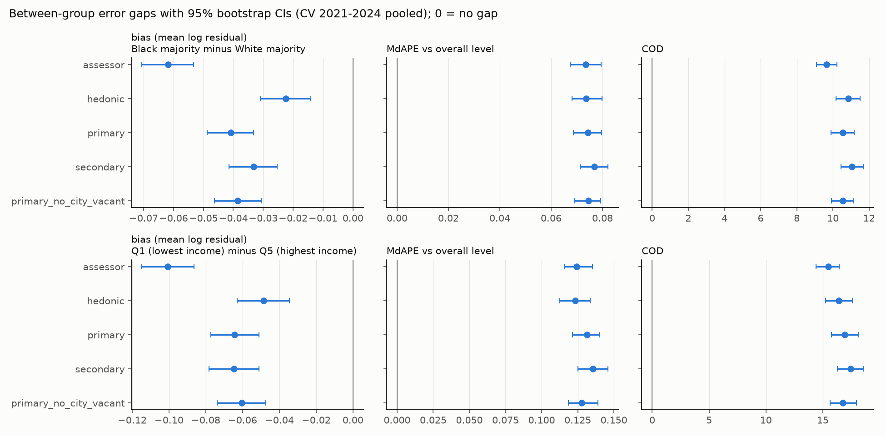

# Stage 8: equity audit (generated by src/avm/stage8_equity.py)

**What this audit tests.** Whether the ERRORS of each method differ by group (accuracy, bias, calibration), not whether the VALUES differ. The models reproduce market price levels by design: if homes sell for less in some areas, a correct model predicts less there, and that is not a model failure. A failure is a method that is systematically too high or too low, less accurate, or differently calibrated for one group than another, measured against the same time-adjusted sale prices for every method. Demographics are used only to form groups; none is a model input (rule 7, asserted below).

**Reading PRB and the calibration slope together.** PRB and PRD computed against sale prices are biased toward showing regressivity, because sale-price noise sits in the denominator. The calibration slope (log price regressed on log prediction) is biased below 1 by noise in the prediction (attenuation). They err in opposite directions, so both are shown side by side; prediction-conditional measures (bias, MdAPE against the overall level, calibration) lead.

**Caveat on bias by group.** Target prices are moved to Jan 1 with a CITYWIDE trend. If some groups' prices rose faster than the city's, their time-adjusted targets stay higher and every method looks biased low there for that reason alone. The bias gaps below therefore mix method error with group-specific appreciation; the comparison BETWEEN methods (same targets) is unaffected.

Methods: assessor (roll Y), hedonic (Stage 4), frozen primary (public data), frozen secondary (assessment-informed), primary without city-owned/vacant features. CV = pooled out-of-fold 2021-2024; 2025 is reported only. Groups with n < 200 are flagged.

## Sample sizes

| split | common_sales |
|---|---|
| CV 2021-2024 | 18944 |
| 2025 | 4197 |

Tracts per group:

| index | race | income |
|---|---|---|
| Black majority | 94 | 0 |
| Hispanic majority | 27 | 0 |
| Q1 (lowest income) | 0 | 55 |
| Q2 | 0 | 47 |
| Q3 | 0 | 39 |
| Q4 | 0 | 35 |
| Q5 (highest income) | 0 | 31 |
| White majority | 65 | 0 |
| no majority (mixed) | 21 | 0 |
| outside city (no SF/duplex parcels) | 95 | 95 |

## Gaps (CV 2021-2024 pooled)

| contrast | measure | method | gap [CI] | |gap| - |assessor gap| [CI] |
|---|---|---|---|---|
| Black majority minus White majority | median_ratio | assessor | -0.031 [-0.038, -0.023] |  |
| Black majority minus White majority | median_ratio | hedonic | -0.019 [-0.028, -0.010] | -0.011 [-0.021, -0.004] |
| Black majority minus White majority | median_ratio | primary | -0.032 [-0.040, -0.024] | 0.002 [-0.007, 0.009] |
| Black majority minus White majority | median_ratio | secondary | -0.022 [-0.030, -0.013] | -0.009 [-0.017, -0.002] |
| Black majority minus White majority | median_ratio | primary_no_city_vacant | -0.030 [-0.038, -0.022] | -0.000 [-0.009, 0.007] |
| Black majority minus White majority | bias_mean_log | assessor | -0.062 [-0.071, -0.053] |  |
| Black majority minus White majority | bias_mean_log | hedonic | -0.022 [-0.031, -0.014] | -0.039 [-0.047, -0.033] |
| Black majority minus White majority | bias_mean_log | primary | -0.041 [-0.049, -0.033] | -0.021 [-0.027, -0.015] |
| Black majority minus White majority | bias_mean_log | secondary | -0.033 [-0.041, -0.025] | -0.029 [-0.034, -0.023] |
| Black majority minus White majority | bias_mean_log | primary_no_city_vacant | -0.038 [-0.046, -0.031] | -0.023 [-0.030, -0.017] |
| Black majority minus White majority | mdape_vs_overall_level | assessor | 0.073 [0.067, 0.080] |  |
| Black majority minus White majority | mdape_vs_overall_level | hedonic | 0.074 [0.068, 0.080] | 0.000 [-0.006, 0.008] |
| Black majority minus White majority | mdape_vs_overall_level | primary | 0.074 [0.069, 0.080] | 0.001 [-0.006, 0.008] |
| Black majority minus White majority | mdape_vs_overall_level | secondary | 0.077 [0.071, 0.082] | 0.003 [-0.003, 0.010] |
| Black majority minus White majority | mdape_vs_overall_level | primary_no_city_vacant | 0.074 [0.069, 0.079] | 0.001 [-0.005, 0.008] |
| Black majority minus White majority | cod | assessor | 9.636 [9.094, 10.230] |  |
| Black majority minus White majority | cod | hedonic | 10.843 [10.174, 11.519] | 1.208 [0.567, 1.871] |
| Black majority minus White majority | cod | primary | 10.552 [9.895, 11.170] | 0.917 [0.322, 1.530] |
| Black majority minus White majority | cod | secondary | 11.058 [10.444, 11.681] | 1.422 [0.875, 1.950] |
| Black majority minus White majority | cod | primary_no_city_vacant | 10.555 [9.930, 11.166] | 0.920 [0.319, 1.529] |
| Black majority minus White majority | prb | assessor | -0.037 [-0.053, -0.021] |  |
| Black majority minus White majority | prb | hedonic | -0.059 [-0.078, -0.038] | 0.022 [0.005, 0.037] |
| Black majority minus White majority | prb | primary | -0.053 [-0.072, -0.034] | 0.016 [0.001, 0.030] |
| Black majority minus White majority | prb | secondary | -0.043 [-0.061, -0.025] | 0.006 [-0.005, 0.017] |
| Black majority minus White majority | prb | primary_no_city_vacant | -0.053 [-0.072, -0.034] | 0.016 [0.001, 0.030] |
| Q1 (lowest income) minus Q5 (highest income) | median_ratio | assessor | -0.057 [-0.070, -0.042] |  |
| Q1 (lowest income) minus Q5 (highest income) | median_ratio | hedonic | -0.035 [-0.052, -0.022] | -0.022 [-0.035, -0.006] |
| Q1 (lowest income) minus Q5 (highest income) | median_ratio | primary | -0.056 [-0.072, -0.042] | -0.001 [-0.014, 0.014] |
| Q1 (lowest income) minus Q5 (highest income) | median_ratio | secondary | -0.056 [-0.071, -0.038] | -0.001 [-0.015, 0.012] |
| Q1 (lowest income) minus Q5 (highest income) | median_ratio | primary_no_city_vacant | -0.052 [-0.066, -0.036] | -0.005 [-0.019, 0.008] |
| Q1 (lowest income) minus Q5 (highest income) | bias_mean_log | assessor | -0.101 [-0.115, -0.086] |  |
| Q1 (lowest income) minus Q5 (highest income) | bias_mean_log | hedonic | -0.048 [-0.063, -0.035] | -0.052 [-0.064, -0.041] |
| Q1 (lowest income) minus Q5 (highest income) | bias_mean_log | primary | -0.064 [-0.077, -0.051] | -0.036 [-0.047, -0.026] |
| Q1 (lowest income) minus Q5 (highest income) | bias_mean_log | secondary | -0.065 [-0.078, -0.051] | -0.036 [-0.045, -0.027] |
| Q1 (lowest income) minus Q5 (highest income) | bias_mean_log | primary_no_city_vacant | -0.060 [-0.074, -0.047] | -0.040 [-0.051, -0.030] |
| Q1 (lowest income) minus Q5 (highest income) | mdape_vs_overall_level | assessor | 0.124 [0.116, 0.135] |  |
| Q1 (lowest income) minus Q5 (highest income) | mdape_vs_overall_level | hedonic | 0.123 [0.113, 0.134] | -0.001 [-0.013, 0.011] |
| Q1 (lowest income) minus Q5 (highest income) | mdape_vs_overall_level | primary | 0.131 [0.121, 0.140] | 0.007 [-0.005, 0.017] |
| Q1 (lowest income) minus Q5 (highest income) | mdape_vs_overall_level | secondary | 0.136 [0.125, 0.146] | 0.011 [0.000, 0.022] |
| Q1 (lowest income) minus Q5 (highest income) | mdape_vs_overall_level | primary_no_city_vacant | 0.128 [0.119, 0.139] | 0.003 [-0.008, 0.015] |
| Q1 (lowest income) minus Q5 (highest income) | cod | assessor | 15.484 [14.404, 16.455] |  |
| Q1 (lowest income) minus Q5 (highest income) | cod | hedonic | 16.424 [15.236, 17.611] | 0.940 [-0.143, 2.113] |
| Q1 (lowest income) minus Q5 (highest income) | cod | primary | 16.918 [15.769, 18.114] | 1.434 [0.440, 2.552] |
| Q1 (lowest income) minus Q5 (highest income) | cod | secondary | 17.446 [16.300, 18.563] | 1.962 [1.027, 2.944] |
| Q1 (lowest income) minus Q5 (highest income) | cod | primary_no_city_vacant | 16.777 [15.665, 17.979] | 1.293 [0.257, 2.379] |
| Q1 (lowest income) minus Q5 (highest income) | prb | assessor | -0.069 [-0.095, -0.044] |  |
| Q1 (lowest income) minus Q5 (highest income) | prb | hedonic | -0.146 [-0.179, -0.113] | 0.076 [0.050, 0.102] |
| Q1 (lowest income) minus Q5 (highest income) | prb | primary | -0.128 [-0.158, -0.097] | 0.058 [0.038, 0.079] |
| Q1 (lowest income) minus Q5 (highest income) | prb | secondary | -0.105 [-0.134, -0.076] | 0.036 [0.018, 0.054] |
| Q1 (lowest income) minus Q5 (highest income) | prb | primary_no_city_vacant | -0.132 [-0.163, -0.101] | 0.063 [0.042, 0.083] |

## Gaps (2025)

| contrast | measure | method | gap [CI] | |gap| - |assessor gap| [CI] |
|---|---|---|---|---|
| Black majority minus White majority | median_ratio | assessor | -0.022 [-0.036, -0.008] |  |
| Black majority minus White majority | median_ratio | hedonic | -0.064 [-0.082, -0.045] | 0.042 [0.025, 0.058] |
| Black majority minus White majority | median_ratio | primary | -0.058 [-0.072, -0.043] | 0.036 [0.020, 0.050] |
| Black majority minus White majority | median_ratio | secondary | -0.066 [-0.082, -0.051] | 0.044 [0.031, 0.058] |
| Black majority minus White majority | median_ratio | primary_no_city_vacant | -0.052 [-0.068, -0.038] | 0.030 [0.016, 0.045] |
| Black majority minus White majority | bias_mean_log | assessor | -0.059 [-0.076, -0.042] |  |
| Black majority minus White majority | bias_mean_log | hedonic | -0.083 [-0.098, -0.066] | 0.024 [0.010, 0.038] |
| Black majority minus White majority | bias_mean_log | primary | -0.073 [-0.088, -0.056] | 0.014 [0.001, 0.027] |
| Black majority minus White majority | bias_mean_log | secondary | -0.079 [-0.094, -0.063] | 0.020 [0.009, 0.031] |
| Black majority minus White majority | bias_mean_log | primary_no_city_vacant | -0.074 [-0.089, -0.058] | 0.015 [0.001, 0.027] |
| Black majority minus White majority | mdape_vs_overall_level | assessor | 0.068 [0.057, 0.079] |  |
| Black majority minus White majority | mdape_vs_overall_level | hedonic | 0.066 [0.054, 0.080] | -0.003 [-0.015, 0.013] |
| Black majority minus White majority | mdape_vs_overall_level | primary | 0.061 [0.051, 0.078] | -0.007 [-0.018, 0.010] |
| Black majority minus White majority | mdape_vs_overall_level | secondary | 0.074 [0.062, 0.086] | 0.006 [-0.006, 0.018] |
| Black majority minus White majority | mdape_vs_overall_level | primary_no_city_vacant | 0.067 [0.057, 0.079] | -0.001 [-0.012, 0.012] |
| Black majority minus White majority | cod | assessor | 9.256 [8.165, 10.370] |  |
| Black majority minus White majority | cod | hedonic | 9.433 [8.262, 10.605] | 0.176 [-0.954, 1.319] |
| Black majority minus White majority | cod | primary | 9.775 [8.620, 10.845] | 0.519 [-0.575, 1.584] |
| Black majority minus White majority | cod | secondary | 11.071 [9.967, 12.139] | 1.815 [0.871, 2.715] |
| Black majority minus White majority | cod | primary_no_city_vacant | 9.773 [8.613, 10.857] | 0.517 [-0.564, 1.570] |
| Black majority minus White majority | prb | assessor | -0.024 [-0.056, 0.007] |  |
| Black majority minus White majority | prb | hedonic | -0.049 [-0.094, -0.006] | 0.025 [-0.009, 0.065] |
| Black majority minus White majority | prb | primary | -0.090 [-0.128, -0.054] | 0.066 [0.034, 0.097] |
| Black majority minus White majority | prb | secondary | -0.049 [-0.082, -0.015] | 0.025 [-0.001, 0.048] |
| Black majority minus White majority | prb | primary_no_city_vacant | -0.085 [-0.121, -0.049] | 0.061 [0.029, 0.092] |
| Q1 (lowest income) minus Q5 (highest income) | median_ratio | assessor | -0.056 [-0.092, -0.023] |  |
| Q1 (lowest income) minus Q5 (highest income) | median_ratio | hedonic | -0.119 [-0.149, -0.094] | 0.063 [0.030, 0.093] |
| Q1 (lowest income) minus Q5 (highest income) | median_ratio | primary | -0.080 [-0.110, -0.051] | 0.023 [-0.008, 0.055] |
| Q1 (lowest income) minus Q5 (highest income) | median_ratio | secondary | -0.098 [-0.127, -0.073] | 0.042 [0.013, 0.072] |
| Q1 (lowest income) minus Q5 (highest income) | median_ratio | primary_no_city_vacant | -0.077 [-0.109, -0.050] | 0.021 [-0.012, 0.052] |
| Q1 (lowest income) minus Q5 (highest income) | bias_mean_log | assessor | -0.111 [-0.140, -0.082] |  |
| Q1 (lowest income) minus Q5 (highest income) | bias_mean_log | hedonic | -0.139 [-0.165, -0.113] | 0.028 [0.008, 0.048] |
| Q1 (lowest income) minus Q5 (highest income) | bias_mean_log | primary | -0.105 [-0.131, -0.078] | -0.006 [-0.025, 0.015] |
| Q1 (lowest income) minus Q5 (highest income) | bias_mean_log | secondary | -0.114 [-0.141, -0.087] | 0.003 [-0.015, 0.021] |
| Q1 (lowest income) minus Q5 (highest income) | bias_mean_log | primary_no_city_vacant | -0.106 [-0.132, -0.079] | -0.005 [-0.024, 0.015] |
| Q1 (lowest income) minus Q5 (highest income) | mdape_vs_overall_level | assessor | 0.110 [0.092, 0.129] |  |
| Q1 (lowest income) minus Q5 (highest income) | mdape_vs_overall_level | hedonic | 0.131 [0.105, 0.153] | 0.021 [-0.003, 0.043] |
| Q1 (lowest income) minus Q5 (highest income) | mdape_vs_overall_level | primary | 0.122 [0.093, 0.142] | 0.012 [-0.016, 0.033] |
| Q1 (lowest income) minus Q5 (highest income) | mdape_vs_overall_level | secondary | 0.140 [0.118, 0.166] | 0.030 [0.008, 0.054] |
| Q1 (lowest income) minus Q5 (highest income) | mdape_vs_overall_level | primary_no_city_vacant | 0.118 [0.099, 0.137] | 0.008 [-0.014, 0.029] |
| Q1 (lowest income) minus Q5 (highest income) | cod | assessor | 14.250 [12.138, 16.401] |  |
| Q1 (lowest income) minus Q5 (highest income) | cod | hedonic | 15.293 [13.276, 17.278] | 1.042 [-1.064, 3.026] |
| Q1 (lowest income) minus Q5 (highest income) | cod | primary | 15.543 [13.618, 17.671] | 1.293 [-0.698, 3.139] |
| Q1 (lowest income) minus Q5 (highest income) | cod | secondary | 17.275 [15.384, 19.361] | 3.025 [1.175, 4.760] |
| Q1 (lowest income) minus Q5 (highest income) | cod | primary_no_city_vacant | 15.719 [13.772, 17.849] | 1.468 [-0.533, 3.380] |
| Q1 (lowest income) minus Q5 (highest income) | prb | assessor | -0.088 [-0.138, -0.038] |  |
| Q1 (lowest income) minus Q5 (highest income) | prb | hedonic | -0.185 [-0.252, -0.120] | 0.097 [0.047, 0.152] |
| Q1 (lowest income) minus Q5 (highest income) | prb | primary | -0.195 [-0.252, -0.141] | 0.107 [0.061, 0.151] |
| Q1 (lowest income) minus Q5 (highest income) | prb | secondary | -0.143 [-0.199, -0.092] | 0.055 [0.015, 0.093] |
| Q1 (lowest income) minus Q5 (highest income) | prb | primary_no_city_vacant | -0.192 [-0.249, -0.138] | 0.104 [0.060, 0.150] |

## Group tables: race/ethnicity majority (CV)

| group | method | n | median ratio | bias (mean log resid) | MdAPE vs overall level | COD | calibration slope |
|---|---|---|---|---|---|---|---|
| Black majority | assessor | 8438 | 0.805 [0.799, 0.811] | -0.247 [-0.254, -0.239] | 19.0% [18.4%, 19.6%] | 24.4 [23.9, 24.8] | 0.768 [0.754, 0.783] |
| Black majority | hedonic | 8438 | 0.978 [0.971, 0.985] | -0.021 [-0.027, -0.014] | 18.8% [18.4%, 19.4%] | 25.8 [25.2, 26.4] | 0.873 [0.856, 0.889] |
| Black majority | primary | 8438 | 1.005 [0.998, 1.012] | 0.001 [-0.006, 0.008] | 17.4% [16.9%, 17.9%] | 23.7 [23.2, 24.3] | 0.892 [0.877, 0.907] |
| Black majority | secondary | 8438 | 1.022 [1.015, 1.029] | 0.011 [0.004, 0.018] | 17.5% [17.0%, 17.9%] | 23.9 [23.4, 24.5] | 0.860 [0.845, 0.876] |
| Black majority | primary_no_city_vacant | 8438 | 1.007 [1.000, 1.014] | 0.004 [-0.003, 0.010] | 17.3% [16.9%, 17.8%] | 23.7 [23.2, 24.3] | 0.896 [0.881, 0.911] |
| Hispanic majority | assessor | 1697 | 0.773 [0.761, 0.783] | -0.281 [-0.295, -0.267] | 17.3% [16.3%, 18.4%] | 21.7 [20.8, 22.6] | 0.681 [0.646, 0.716] |
| Hispanic majority | hedonic | 1697 | 0.966 [0.952, 0.982] | -0.025 [-0.037, -0.012] | 16.1% [14.8%, 16.9%] | 21.8 [20.8, 22.8] | 0.846 [0.805, 0.887] |
| Hispanic majority | primary | 1697 | 0.986 [0.974, 1.000] | -0.007 [-0.019, 0.006] | 15.5% [14.8%, 16.4%] | 21.2 [20.3, 22.2] | 0.846 [0.805, 0.888] |
| Hispanic majority | secondary | 1697 | 0.994 [0.979, 1.010] | -0.005 [-0.017, 0.009] | 15.5% [14.3%, 16.2%] | 21.4 [20.4, 22.4] | 0.811 [0.770, 0.853] |
| Hispanic majority | primary_no_city_vacant | 1697 | 0.987 [0.972, 1.003] | -0.006 [-0.018, 0.007] | 15.7% [14.8%, 16.5%] | 21.4 [20.4, 22.4] | 0.843 [0.801, 0.885] |
| White majority | assessor | 6548 | 0.835 [0.831, 0.840] | -0.185 [-0.190, -0.180] | 11.6% [11.4%, 12.0%] | 14.7 [14.4, 15.1] | 0.799 [0.783, 0.815] |
| White majority | hedonic | 6548 | 0.997 [0.992, 1.001] | 0.002 [-0.003, 0.007] | 11.5% [11.2%, 11.8%] | 14.9 [14.6, 15.3] | 0.898 [0.878, 0.918] |
| White majority | primary | 6548 | 1.038 [1.033, 1.042] | 0.042 [0.038, 0.047] | 10.0% [9.7%, 10.3%] | 13.2 [12.9, 13.5] | 0.935 [0.919, 0.951] |
| White majority | secondary | 6548 | 1.043 [1.039, 1.047] | 0.045 [0.040, 0.049] | 9.8% [9.5%, 10.1%] | 12.9 [12.6, 13.2] | 0.918 [0.904, 0.933] |
| White majority | primary_no_city_vacant | 6548 | 1.037 [1.032, 1.041] | 0.042 [0.038, 0.046] | 9.9% [9.6%, 10.2%] | 13.2 [12.9, 13.5] | 0.939 [0.923, 0.955] |
| no majority (mixed) | assessor | 2241 | 0.829 [0.822, 0.834] | -0.200 [-0.209, -0.191] | 11.8% [11.1%, 12.4%] | 15.6 [15.0, 16.2] | 0.740 [0.701, 0.779] |
| no majority (mixed) | hedonic | 2241 | 1.000 [0.991, 1.009] | 0.005 [-0.004, 0.013] | 10.8% [10.3%, 11.4%] | 15.7 [14.9, 16.4] | 0.859 [0.817, 0.900] |
| no majority (mixed) | primary | 2241 | 1.015 [1.008, 1.022] | 0.022 [0.013, 0.030] | 9.8% [9.3%, 10.3%] | 14.2 [13.5, 14.9] | 0.897 [0.859, 0.935] |
| no majority (mixed) | secondary | 2241 | 1.028 [1.020, 1.036] | 0.028 [0.019, 0.036] | 9.7% [9.1%, 10.2%] | 13.9 [13.3, 14.6] | 0.893 [0.857, 0.928] |
| no majority (mixed) | primary_no_city_vacant | 2241 | 1.015 [1.009, 1.022] | 0.022 [0.013, 0.029] | 9.7% [9.3%, 10.4%] | 14.1 [13.4, 14.8] | 0.903 [0.865, 0.941] |
| no tract match | assessor | 20 (< 200) | 0.582 [0.506, 0.704] | -0.536 [-0.737, -0.369] | 32.2% [22.5%, 38.2%] | 33.2 [20.2, 44.1] | 0.612 [0.398, 0.825] |
| no tract match | hedonic | 20 (< 200) | 0.892 [0.698, 1.078] | -0.149 [-0.329, 0.030] | 25.4% [17.9%, 36.1%] | 34.8 [19.7, 55.7] | 0.670 [0.353, 0.988] |
| no tract match | primary | 20 (< 200) | 1.079 [0.805, 1.539] | 0.019 [-0.243, 0.259] | 47.5% [23.9%, 58.5%] | 46.0 [26.3, 64.9] | 0.323 [-0.261, 0.907] |
| no tract match | secondary | 20 (< 200) | 0.798 [0.690, 0.931] | -0.227 [-0.405, -0.058] | 28.3% [18.2%, 38.2%] | 30.7 [16.3, 47.9] | 0.691 [0.401, 0.980] |
| no tract match | primary_no_city_vacant | 20 (< 200) | 1.067 [0.784, 1.579] | 0.026 [-0.230, 0.258] | 47.3% [25.0%, 63.9%] | 45.9 [25.9, 63.7] | 0.362 [-0.245, 0.970] |

## Group tables: income quintile (CV)

| group | method | n | median ratio | bias (mean log resid) | MdAPE vs overall level | COD | calibration slope |
|---|---|---|---|---|---|---|---|
| Q1 (lowest income) | assessor | 3203 | 0.781 [0.770, 0.796] | -0.281 [-0.294, -0.268] | 23.8% [23.1%, 24.9%] | 29.6 [28.6, 30.5] | 0.730 [0.703, 0.757] |
| Q1 (lowest income) | hedonic | 3203 | 0.958 [0.943, 0.969] | -0.048 [-0.061, -0.035] | 23.9% [22.9%, 24.9%] | 31.1 [30.0, 32.2] | 0.865 [0.834, 0.896] |
| Q1 (lowest income) | primary | 3203 | 0.982 [0.968, 0.995] | -0.022 [-0.034, -0.009] | 22.8% [21.9%, 23.6%] | 29.6 [28.5, 30.7] | 0.876 [0.848, 0.903] |
| Q1 (lowest income) | secondary | 3203 | 0.987 [0.974, 1.004] | -0.021 [-0.034, -0.008] | 23.1% [22.2%, 24.1%] | 29.9 [28.8, 31.0] | 0.837 [0.809, 0.864] |
| Q1 (lowest income) | primary_no_city_vacant | 3203 | 0.985 [0.971, 1.001] | -0.018 [-0.031, -0.006] | 22.3% [21.5%, 23.4%] | 29.4 [28.3, 30.6] | 0.881 [0.854, 0.909] |
| Q2 | assessor | 3467 | 0.792 [0.784, 0.801] | -0.258 [-0.269, -0.247] | 18.6% [17.9%, 19.4%] | 23.8 [23.1, 24.6] | 0.781 [0.760, 0.801] |
| Q2 | hedonic | 3467 | 0.984 [0.973, 0.994] | -0.010 [-0.021, 0.000] | 18.4% [17.7%, 19.1%] | 25.0 [24.2, 25.9] | 0.909 [0.886, 0.933] |
| Q2 | primary | 3467 | 1.002 [0.993, 1.013] | 0.003 [-0.007, 0.013] | 17.6% [16.7%, 18.3%] | 23.6 [22.8, 24.5] | 0.896 [0.874, 0.918] |
| Q2 | secondary | 3467 | 1.022 [1.012, 1.031] | 0.014 [0.004, 0.023] | 16.6% [15.9%, 17.4%] | 23.1 [22.4, 23.9] | 0.880 [0.858, 0.901] |
| Q2 | primary_no_city_vacant | 3467 | 1.005 [0.993, 1.014] | 0.004 [-0.006, 0.014] | 17.4% [16.6%, 18.1%] | 23.7 [23.0, 24.6] | 0.896 [0.874, 0.918] |
| Q3 | assessor | 4063 | 0.821 [0.814, 0.827] | -0.214 [-0.221, -0.206] | 14.6% [14.0%, 15.1%] | 18.6 [18.1, 19.1] | 0.765 [0.740, 0.791] |
| Q3 | hedonic | 4063 | 0.992 [0.984, 0.999] | -0.002 [-0.010, 0.005] | 13.6% [13.0%, 14.1%] | 18.8 [18.2, 19.4] | 0.853 [0.825, 0.880] |
| Q3 | primary | 4063 | 1.019 [1.010, 1.025] | 0.020 [0.014, 0.027] | 12.6% [12.2%, 13.2%] | 17.1 [16.6, 17.7] | 0.899 [0.872, 0.926] |
| Q3 | secondary | 4063 | 1.035 [1.027, 1.041] | 0.033 [0.026, 0.040] | 12.9% [12.3%, 13.3%] | 17.6 [17.0, 18.2] | 0.872 [0.845, 0.899] |
| Q3 | primary_no_city_vacant | 4063 | 1.019 [1.013, 1.026] | 0.022 [0.015, 0.028] | 12.8% [12.3%, 13.2%] | 17.1 [16.6, 17.6] | 0.904 [0.877, 0.931] |
| Q4 | assessor | 4071 | 0.825 [0.819, 0.832] | -0.199 [-0.206, -0.192] | 12.3% [11.8%, 12.8%] | 15.9 [15.4, 16.3] | 0.755 [0.732, 0.778] |
| Q4 | hedonic | 4071 | 0.998 [0.991, 1.003] | 0.001 [-0.006, 0.007] | 11.7% [11.2%, 12.1%] | 15.7 [15.3, 16.3] | 0.851 [0.823, 0.879] |
| Q4 | primary | 4071 | 1.024 [1.019, 1.030] | 0.031 [0.026, 0.037] | 10.0% [9.7%, 10.4%] | 14.1 [13.6, 14.5] | 0.931 [0.905, 0.956] |
| Q4 | secondary | 4071 | 1.033 [1.027, 1.038] | 0.037 [0.031, 0.042] | 10.1% [9.7%, 10.4%] | 13.9 [13.5, 14.3] | 0.908 [0.884, 0.932] |
| Q4 | primary_no_city_vacant | 4071 | 1.025 [1.020, 1.030] | 0.031 [0.026, 0.037] | 10.3% [9.9%, 10.6%] | 14.0 [13.6, 14.5] | 0.937 [0.912, 0.962] |
| Q5 (highest income) | assessor | 4120 | 0.838 [0.832, 0.844] | -0.181 [-0.186, -0.175] | 11.4% [11.0%, 11.8%] | 14.1 [13.8, 14.5] | 0.808 [0.788, 0.827] |
| Q5 (highest income) | hedonic | 4120 | 0.993 [0.986, 1.000] | 0.001 [-0.005, 0.006] | 11.6% [11.2%, 11.9%] | 14.7 [14.3, 15.1] | 0.908 [0.886, 0.930] |
| Q5 (highest income) | primary | 4120 | 1.038 [1.033, 1.044] | 0.043 [0.038, 0.048] | 9.7% [9.3%, 10.0%] | 12.7 [12.3, 13.0] | 0.929 [0.910, 0.949] |
| Q5 (highest income) | secondary | 4120 | 1.043 [1.039, 1.048] | 0.043 [0.038, 0.048] | 9.6% [9.2%, 10.0%] | 12.5 [12.1, 12.8] | 0.917 [0.899, 0.935] |
| Q5 (highest income) | primary_no_city_vacant | 4120 | 1.037 [1.031, 1.042] | 0.042 [0.037, 0.047] | 9.5% [9.2%, 9.9%] | 12.6 [12.3, 13.0] | 0.928 [0.909, 0.948] |
| no tract match | assessor | 20 (< 200) | 0.582 [0.506, 0.704] | -0.536 [-0.723, -0.360] | 32.2% [22.5%, 38.2%] | 33.2 [20.3, 44.1] | 0.612 [0.398, 0.825] |
| no tract match | hedonic | 20 (< 200) | 0.892 [0.698, 1.075] | -0.149 [-0.327, 0.042] | 25.4% [17.9%, 36.1%] | 34.8 [19.5, 55.2] | 0.670 [0.353, 0.988] |
| no tract match | primary | 20 (< 200) | 1.079 [0.805, 1.539] | 0.019 [-0.231, 0.260] | 47.5% [23.9%, 56.6%] | 46.0 [26.6, 63.8] | 0.323 [-0.261, 0.907] |
| no tract match | secondary | 20 (< 200) | 0.798 [0.690, 0.931] | -0.227 [-0.404, -0.056] | 28.3% [19.1%, 38.2%] | 30.7 [16.7, 47.4] | 0.691 [0.401, 0.980] |
| no tract match | primary_no_city_vacant | 20 (< 200) | 1.067 [0.784, 1.579] | 0.026 [-0.224, 0.263] | 47.3% [25.0%, 60.6%] | 45.9 [26.6, 62.6] | 0.362 [-0.245, 0.970] |

## Group tables: race/ethnicity majority (2025)

| group | method | n | median ratio | bias (mean log resid) | MdAPE vs overall level | COD | calibration slope |
|---|---|---|---|---|---|---|---|
| Black majority | assessor | 1812 | 0.883 [0.872, 0.895] | -0.169 [-0.184, -0.154] | 17.3% [16.1%, 18.1%] | 22.2 [21.2, 23.1] | 0.750 [0.716, 0.784] |
| Black majority | hedonic | 1812 | 0.967 [0.951, 0.981] | -0.047 [-0.061, -0.034] | 16.9% [15.9%, 18.2%] | 22.6 [21.6, 23.6] | 0.861 [0.827, 0.895] |
| Black majority | primary | 1812 | 0.963 [0.951, 0.976] | -0.047 [-0.060, -0.033] | 15.3% [14.5%, 16.7%] | 21.6 [20.6, 22.5] | 0.887 [0.854, 0.921] |
| Black majority | secondary | 1812 | 0.970 [0.957, 0.983] | -0.045 [-0.058, -0.031] | 16.5% [15.4%, 17.6%] | 22.3 [21.3, 23.2] | 0.859 [0.826, 0.893] |
| Black majority | primary_no_city_vacant | 1812 | 0.969 [0.955, 0.980] | -0.048 [-0.061, -0.034] | 15.8% [15.0%, 16.7%] | 21.5 [20.6, 22.5] | 0.883 [0.849, 0.917] |
| Hispanic majority | assessor | 366 | 0.851 [0.822, 0.873] | -0.192 [-0.220, -0.165] | 15.8% [14.3%, 18.7%] | 20.6 [18.9, 22.4] | 0.487 [0.422, 0.551] |
| Hispanic majority | hedonic | 366 | 0.933 [0.900, 0.957] | -0.069 [-0.093, -0.046] | 16.0% [14.0%, 18.4%] | 18.9 [17.3, 20.5] | 0.611 [0.535, 0.687] |
| Hispanic majority | primary | 366 | 0.947 [0.925, 0.971] | -0.058 [-0.080, -0.037] | 13.8% [12.4%, 15.9%] | 16.8 [15.4, 18.3] | 0.703 [0.626, 0.781] |
| Hispanic majority | secondary | 366 | 0.958 [0.931, 0.989] | -0.058 [-0.081, -0.036] | 14.4% [12.5%, 16.2%] | 17.1 [15.6, 18.5] | 0.654 [0.577, 0.730] |
| Hispanic majority | primary_no_city_vacant | 366 | 0.944 [0.921, 0.968] | -0.061 [-0.082, -0.040] | 14.7% [12.4%, 16.8%] | 17.2 [15.7, 18.6] | 0.685 [0.607, 0.764] |
| White majority | assessor | 1546 | 0.906 [0.897, 0.914] | -0.110 [-0.118, -0.101] | 10.5% [9.9%, 10.9%] | 12.9 [12.4, 13.5] | 0.808 [0.773, 0.843] |
| White majority | hedonic | 1546 | 1.031 [1.020, 1.041] | 0.035 [0.027, 0.044] | 10.3% [9.6%, 10.9%] | 13.2 [12.5, 13.7] | 0.898 [0.860, 0.936] |
| White majority | primary | 1546 | 1.021 [1.013, 1.028] | 0.026 [0.018, 0.033] | 9.2% [8.2%, 9.8%] | 11.8 [11.3, 12.4] | 0.896 [0.866, 0.925] |
| White majority | secondary | 1546 | 1.036 [1.029, 1.046] | 0.034 [0.027, 0.041] | 9.1% [8.6%, 9.6%] | 11.2 [10.7, 11.7] | 0.929 [0.898, 0.961] |
| White majority | primary_no_city_vacant | 1546 | 1.021 [1.012, 1.031] | 0.026 [0.018, 0.033] | 9.1% [8.3%, 9.7%] | 11.8 [11.2, 12.3] | 0.897 [0.867, 0.926] |
| no majority (mixed) | assessor | 473 | 0.906 [0.890, 0.927] | -0.108 [-0.125, -0.090] | 11.5% [10.3%, 12.8%] | 14.8 [13.6, 16.0] | 0.725 [0.652, 0.798] |
| no majority (mixed) | hedonic | 473 | 1.036 [1.012, 1.062] | 0.021 [0.004, 0.036] | 11.4% [10.5%, 12.5%] | 14.2 [13.0, 15.3] | 0.798 [0.715, 0.880] |
| no majority (mixed) | primary | 473 | 1.019 [1.003, 1.044] | 0.011 [-0.005, 0.025] | 10.1% [9.0%, 11.2%] | 12.6 [11.5, 13.5] | 0.854 [0.768, 0.940] |
| no majority (mixed) | secondary | 473 | 1.021 [1.007, 1.042] | 0.021 [0.006, 0.036] | 10.6% [9.5%, 11.4%] | 13.0 [12.0, 13.9] | 0.864 [0.786, 0.943] |
| no majority (mixed) | primary_no_city_vacant | 473 | 1.021 [0.996, 1.040] | 0.012 [-0.004, 0.027] | 10.4% [8.9%, 11.3%] | 12.7 [11.7, 13.7] | 0.854 [0.768, 0.941] |

## Group tables: income quintile (2025)

| group | method | n | median ratio | bias (mean log resid) | MdAPE vs overall level | COD | calibration slope |
|---|---|---|---|---|---|---|---|
| Q1 (lowest income) | assessor | 762 | 0.852 [0.817, 0.884] | -0.214 [-0.241, -0.186] | 21.5% [19.8%, 23.2%] | 27.3 [25.3, 29.2] | 0.715 [0.657, 0.773] |
| Q1 (lowest income) | hedonic | 762 | 0.908 [0.881, 0.930] | -0.102 [-0.127, -0.077] | 23.4% [20.9%, 25.4%] | 28.4 [26.5, 30.4] | 0.870 [0.811, 0.929] |
| Q1 (lowest income) | primary | 762 | 0.942 [0.916, 0.971] | -0.072 [-0.095, -0.046] | 21.3% [18.7%, 23.0%] | 27.3 [25.4, 29.3] | 0.874 [0.814, 0.933] |
| Q1 (lowest income) | secondary | 762 | 0.937 [0.914, 0.957] | -0.081 [-0.106, -0.055] | 22.7% [20.9%, 25.2%] | 28.3 [26.5, 30.2] | 0.834 [0.776, 0.892] |
| Q1 (lowest income) | primary_no_city_vacant | 762 | 0.946 [0.919, 0.971] | -0.072 [-0.097, -0.047] | 20.9% [19.2%, 22.5%] | 27.4 [25.6, 29.5] | 0.869 [0.810, 0.929] |
| Q2 | assessor | 725 | 0.877 [0.865, 0.901] | -0.161 [-0.182, -0.140] | 15.6% [14.8%, 17.2%] | 20.4 [19.1, 21.6] | 0.754 [0.700, 0.809] |
| Q2 | hedonic | 725 | 0.959 [0.939, 0.982] | -0.044 [-0.062, -0.025] | 14.5% [13.0%, 16.7%] | 20.2 [18.8, 21.5] | 0.865 [0.814, 0.917] |
| Q2 | primary | 725 | 0.952 [0.943, 0.972] | -0.052 [-0.071, -0.034] | 14.8% [13.2%, 16.2%] | 19.2 [17.9, 20.5] | 0.871 [0.821, 0.922] |
| Q2 | secondary | 725 | 0.981 [0.960, 0.995] | -0.034 [-0.052, -0.015] | 15.3% [14.4%, 16.7%] | 19.5 [18.3, 20.8] | 0.858 [0.808, 0.908] |
| Q2 | primary_no_city_vacant | 725 | 0.957 [0.945, 0.980] | -0.053 [-0.072, -0.034] | 14.6% [13.0%, 15.9%] | 19.2 [17.9, 20.5] | 0.866 [0.815, 0.917] |
| Q3 | assessor | 840 | 0.895 [0.882, 0.909] | -0.137 [-0.154, -0.120] | 12.8% [12.1%, 13.8%] | 17.0 [16.0, 18.1] | 0.732 [0.679, 0.786] |
| Q3 | hedonic | 840 | 1.011 [0.993, 1.024] | 0.006 [-0.008, 0.020] | 12.4% [11.5%, 13.6%] | 16.5 [15.5, 17.6] | 0.848 [0.793, 0.903] |
| Q3 | primary | 840 | 0.990 [0.975, 1.004] | -0.014 [-0.027, -0.000] | 11.5% [10.4%, 12.2%] | 15.1 [14.0, 16.0] | 0.906 [0.853, 0.959] |
| Q3 | secondary | 840 | 1.001 [0.988, 1.012] | -0.009 [-0.022, 0.005] | 11.4% [10.6%, 12.4%] | 15.1 [14.1, 16.0] | 0.876 [0.824, 0.928] |
| Q3 | primary_no_city_vacant | 840 | 0.987 [0.973, 0.998] | -0.016 [-0.030, -0.003] | 11.7% [10.9%, 12.6%] | 15.2 [14.2, 16.1] | 0.894 [0.842, 0.946] |
| Q4 | assessor | 918 | 0.902 [0.890, 0.915] | -0.114 [-0.127, -0.101] | 10.9% [10.4%, 11.9%] | 14.1 [13.3, 14.8] | 0.745 [0.693, 0.797] |
| Q4 | hedonic | 918 | 1.035 [1.016, 1.042] | 0.025 [0.013, 0.036] | 11.0% [10.3%, 11.9%] | 13.8 [13.0, 14.6] | 0.878 [0.820, 0.936] |
| Q4 | primary | 918 | 1.016 [1.003, 1.025] | 0.011 [0.000, 0.021] | 9.6% [8.9%, 10.6%] | 12.3 [11.6, 13.0] | 0.884 [0.833, 0.934] |
| Q4 | secondary | 918 | 1.032 [1.021, 1.044] | 0.023 [0.013, 0.034] | 10.4% [9.5%, 11.0%] | 12.4 [11.7, 13.2] | 0.854 [0.808, 0.900] |
| Q4 | primary_no_city_vacant | 918 | 1.012 [1.001, 1.025] | 0.013 [0.002, 0.023] | 9.5% [8.7%, 10.5%] | 12.3 [11.6, 13.0] | 0.892 [0.843, 0.942] |
| Q5 (highest income) | assessor | 952 | 0.908 [0.896, 0.919] | -0.102 [-0.114, -0.092] | 10.5% [9.7%, 11.1%] | 13.0 [12.3, 13.7] | 0.830 [0.793, 0.868] |
| Q5 (highest income) | hedonic | 952 | 1.028 [1.014, 1.040] | 0.037 [0.027, 0.047] | 10.2% [9.5%, 10.9%] | 13.1 [12.4, 13.8] | 0.897 [0.853, 0.941] |
| Q5 (highest income) | primary | 952 | 1.022 [1.014, 1.033] | 0.034 [0.024, 0.043] | 9.1% [8.2%, 10.0%] | 11.8 [11.1, 12.4] | 0.896 [0.862, 0.930] |
| Q5 (highest income) | secondary | 952 | 1.035 [1.024, 1.047] | 0.034 [0.024, 0.042] | 8.7% [8.1%, 9.4%] | 11.0 [10.4, 11.6] | 0.936 [0.901, 0.971] |
| Q5 (highest income) | primary_no_city_vacant | 952 | 1.023 [1.013, 1.036] | 0.034 [0.025, 0.043] | 9.1% [8.1%, 9.8%] | 11.7 [11.0, 12.4] | 0.897 [0.863, 0.930] |

## PRB vs calibration slope, side by side (CV)

| grouping | group | method | PRB | PRD | MKI | calibration slope |
|---|---|---|---|---|---|---|
| race_group | Black majority | assessor | -0.002 [-0.013, 0.010] | 1.039 | 0.88 | 0.768 [0.754, 0.783] |
| race_group | Black majority | hedonic | -0.121 [-0.136, -0.106] | 1.072 | 0.784 | 0.873 [0.856, 0.889] |
| race_group | Black majority | primary | -0.112 [-0.126, -0.098] | 1.067 | 0.787 | 0.892 [0.877, 0.907] |
| race_group | Black majority | secondary | -0.086 [-0.100, -0.074] | 1.064 | 0.791 | 0.860 [0.845, 0.876] |
| race_group | Black majority | primary_no_city_vacant | -0.115 [-0.129, -0.101] | 1.068 | 0.786 | 0.896 [0.881, 0.911] |
| race_group | Hispanic majority | assessor | 0.010 [-0.018, 0.040] | 1.03 | 0.816 | 0.681 [0.646, 0.716] |
| race_group | Hispanic majority | hedonic | -0.185 [-0.220, -0.151] | 1.057 | 0.641 | 0.846 [0.805, 0.887] |
| race_group | Hispanic majority | primary | -0.179 [-0.213, -0.146] | 1.056 | 0.64 | 0.846 [0.805, 0.888] |
| race_group | Hispanic majority | secondary | -0.155 [-0.188, -0.123] | 1.054 | 0.648 | 0.811 [0.770, 0.853] |
| race_group | Hispanic majority | primary_no_city_vacant | -0.179 [-0.214, -0.145] | 1.056 | 0.636 | 0.843 [0.801, 0.885] |
| race_group | White majority | assessor | 0.035 [0.025, 0.046] | 1.011 | 0.911 | 0.799 [0.783, 0.815] |
| race_group | White majority | hedonic | -0.063 [-0.076, -0.051] | 1.028 | 0.777 | 0.898 [0.878, 0.918] |
| race_group | White majority | primary | -0.059 [-0.072, -0.047] | 1.022 | 0.821 | 0.935 [0.919, 0.951] |
| race_group | White majority | secondary | -0.043 [-0.055, -0.033] | 1.02 | 0.841 | 0.918 [0.904, 0.933] |
| race_group | White majority | primary_no_city_vacant | -0.062 [-0.075, -0.049] | 1.023 | 0.818 | 0.939 [0.923, 0.955] |
| race_group | no majority (mixed) | assessor | 0.024 [-0.003, 0.050] | 1.014 | 0.884 | 0.740 [0.701, 0.779] |
| race_group | no majority (mixed) | hedonic | -0.111 [-0.146, -0.079] | 1.031 | 0.762 | 0.859 [0.817, 0.900] |
| race_group | no majority (mixed) | primary | -0.101 [-0.131, -0.071] | 1.028 | 0.775 | 0.897 [0.859, 0.935] |
| race_group | no majority (mixed) | secondary | -0.091 [-0.122, -0.061] | 1.026 | 0.789 | 0.893 [0.857, 0.928] |
| race_group | no majority (mixed) | primary_no_city_vacant | -0.105 [-0.137, -0.075] | 1.028 | 0.773 | 0.903 [0.865, 0.941] |
| race_group | no tract match | assessor | 0.196 [-0.079, 0.417] | 0.964 | 1.185 | 0.612 [0.398, 0.825] |
| race_group | no tract match | hedonic | -0.026 [-0.244, 0.251] | 1.078 | 0.883 | 0.670 [0.353, 0.988] |
| race_group | no tract match | primary | -0.343 [-0.728, 0.132] | 1.218 | 0.143 | 0.323 [-0.261, 0.907] |
| race_group | no tract match | secondary | 0.018 [-0.198, 0.251] | 1.052 | 0.902 | 0.691 [0.401, 0.980] |
| race_group | no tract match | primary_no_city_vacant | -0.389 [-0.794, 0.088] | 1.218 | 0.147 | 0.362 [-0.245, 0.970] |
| income_group | Q1 (lowest income) | assessor | -0.037 [-0.059, -0.016] | 1.075 | 0.756 | 0.730 [0.703, 0.757] |
| income_group | Q1 (lowest income) | hedonic | -0.208 [-0.238, -0.180] | 1.119 | 0.639 | 0.865 [0.834, 0.896] |
| income_group | Q1 (lowest income) | primary | -0.174 [-0.201, -0.148] | 1.109 | 0.659 | 0.876 [0.848, 0.903] |
| income_group | Q1 (lowest income) | secondary | -0.142 [-0.168, -0.117] | 1.104 | 0.669 | 0.837 [0.809, 0.864] |
| income_group | Q1 (lowest income) | primary_no_city_vacant | -0.178 [-0.204, -0.151] | 1.109 | 0.659 | 0.881 [0.854, 0.909] |
| income_group | Q2 | assessor | 0.001 [-0.014, 0.017] | 1.033 | 0.913 | 0.781 [0.760, 0.801] |
| income_group | Q2 | hedonic | -0.139 [-0.160, -0.118] | 1.072 | 0.792 | 0.909 [0.886, 0.933] |
| income_group | Q2 | primary | -0.105 [-0.124, -0.086] | 1.062 | 0.812 | 0.896 [0.874, 0.918] |
| income_group | Q2 | secondary | -0.089 [-0.106, -0.072] | 1.059 | 0.818 | 0.880 [0.858, 0.901] |
| income_group | Q2 | primary_no_city_vacant | -0.108 [-0.126, -0.089] | 1.063 | 0.809 | 0.896 [0.874, 0.918] |
| income_group | Q3 | assessor | 0.025 [0.009, 0.041] | 1.019 | 0.891 | 0.765 [0.740, 0.791] |
| income_group | Q3 | hedonic | -0.062 [-0.081, -0.042] | 1.038 | 0.787 | 0.853 [0.825, 0.880] |
| income_group | Q3 | primary | -0.081 [-0.102, -0.062] | 1.034 | 0.796 | 0.899 [0.872, 0.926] |
| income_group | Q3 | secondary | -0.070 [-0.090, -0.051] | 1.036 | 0.785 | 0.872 [0.845, 0.899] |
| income_group | Q3 | primary_no_city_vacant | -0.085 [-0.105, -0.065] | 1.035 | 0.793 | 0.904 [0.877, 0.931] |
| income_group | Q4 | assessor | 0.042 [0.025, 0.060] | 1.013 | 0.904 | 0.755 [0.732, 0.778] |
| income_group | Q4 | hedonic | -0.067 [-0.090, -0.047] | 1.029 | 0.769 | 0.851 [0.823, 0.879] |
| income_group | Q4 | primary | -0.097 [-0.116, -0.076] | 1.028 | 0.773 | 0.931 [0.905, 0.956] |
| income_group | Q4 | secondary | -0.077 [-0.095, -0.058] | 1.025 | 0.801 | 0.908 [0.884, 0.932] |
| income_group | Q4 | primary_no_city_vacant | -0.103 [-0.122, -0.083] | 1.029 | 0.77 | 0.937 [0.912, 0.962] |
| income_group | Q5 (highest income) | assessor | 0.032 [0.019, 0.045] | 1.009 | 0.911 | 0.808 [0.788, 0.827] |
| income_group | Q5 (highest income) | hedonic | -0.063 [-0.079, -0.046] | 1.026 | 0.78 | 0.908 [0.886, 0.930] |
| income_group | Q5 (highest income) | primary | -0.046 [-0.062, -0.032] | 1.02 | 0.831 | 0.929 [0.910, 0.949] |
| income_group | Q5 (highest income) | secondary | -0.037 [-0.051, -0.024] | 1.018 | 0.845 | 0.917 [0.899, 0.935] |
| income_group | Q5 (highest income) | primary_no_city_vacant | -0.046 [-0.061, -0.031] | 1.021 | 0.83 | 0.928 [0.909, 0.948] |
| income_group | no tract match | assessor | 0.196 [-0.079, 0.431] | 0.964 | 1.185 | 0.612 [0.398, 0.825] |
| income_group | no tract match | hedonic | -0.026 [-0.240, 0.260] | 1.078 | 0.883 | 0.670 [0.353, 0.988] |
| income_group | no tract match | primary | -0.343 [-0.721, 0.149] | 1.218 | 0.143 | 0.323 [-0.261, 0.907] |
| income_group | no tract match | secondary | 0.018 [-0.180, 0.259] | 1.052 | 0.902 | 0.691 [0.401, 0.980] |
| income_group | no tract match | primary_no_city_vacant | -0.389 [-0.793, 0.100] | 1.218 | 0.147 | 0.362 [-0.245, 0.970] |

## PRB vs calibration slope, side by side (2025)

| grouping | group | method | PRB | PRD | MKI | calibration slope |
|---|---|---|---|---|---|---|
| race_group | Black majority | assessor | -0.001 [-0.025, 0.022] | 1.031 | 0.898 | 0.750 [0.716, 0.784] |
| race_group | Black majority | hedonic | -0.097 [-0.129, -0.070] | 1.051 | 0.828 | 0.861 [0.827, 0.895] |
| race_group | Black majority | primary | -0.115 [-0.144, -0.089] | 1.054 | 0.815 | 0.887 [0.854, 0.921] |
| race_group | Black majority | secondary | -0.097 [-0.125, -0.071] | 1.053 | 0.816 | 0.859 [0.826, 0.893] |
| race_group | Black majority | primary_no_city_vacant | -0.111 [-0.140, -0.085] | 1.053 | 0.815 | 0.883 [0.849, 0.917] |
| race_group | Hispanic majority | assessor | 0.171 [0.101, 0.242] | 1.014 | 0.816 | 0.487 [0.422, 0.551] |
| race_group | Hispanic majority | hedonic | 0.022 [-0.048, 0.090] | 1.024 | 0.673 | 0.611 [0.535, 0.687] |
| race_group | Hispanic majority | primary | -0.061 [-0.128, 0.001] | 1.025 | 0.658 | 0.703 [0.626, 0.781] |
| race_group | Hispanic majority | secondary | -0.009 [-0.077, 0.054] | 1.022 | 0.714 | 0.654 [0.577, 0.730] |
| race_group | Hispanic majority | primary_no_city_vacant | -0.058 [-0.128, 0.009] | 1.026 | 0.658 | 0.685 [0.607, 0.764] |
| race_group | White majority | assessor | 0.022 [0.001, 0.045] | 1.01 | 0.882 | 0.808 [0.773, 0.843] |
| race_group | White majority | hedonic | -0.048 [-0.079, -0.014] | 1.018 | 0.815 | 0.898 [0.860, 0.936] |
| race_group | White majority | primary | -0.025 [-0.049, -0.001] | 1.013 | 0.872 | 0.896 [0.866, 0.925] |
| race_group | White majority | secondary | -0.048 [-0.069, -0.027] | 1.016 | 0.849 | 0.929 [0.898, 0.961] |
| race_group | White majority | primary_no_city_vacant | -0.026 [-0.050, -0.002] | 1.013 | 0.871 | 0.897 [0.867, 0.926] |
| race_group | no majority (mixed) | assessor | 0.041 [-0.015, 0.102] | 1.012 | 0.865 | 0.725 [0.652, 0.798] |
| race_group | no majority (mixed) | hedonic | -0.026 [-0.083, 0.035] | 1.019 | 0.756 | 0.798 [0.715, 0.880] |
| race_group | no majority (mixed) | primary | -0.048 [-0.099, 0.006] | 1.018 | 0.772 | 0.854 [0.768, 0.940] |
| race_group | no majority (mixed) | secondary | -0.054 [-0.103, -0.001] | 1.018 | 0.789 | 0.864 [0.786, 0.943] |
| race_group | no majority (mixed) | primary_no_city_vacant | -0.051 [-0.099, 0.004] | 1.019 | 0.772 | 0.854 [0.768, 0.941] |
| income_group | Q1 (lowest income) | assessor | -0.067 [-0.110, -0.026] | 1.065 | 0.767 | 0.715 [0.657, 0.773] |
| income_group | Q1 (lowest income) | hedonic | -0.212 [-0.264, -0.163] | 1.095 | 0.659 | 0.870 [0.811, 0.929] |
| income_group | Q1 (lowest income) | primary | -0.206 [-0.255, -0.158] | 1.094 | 0.651 | 0.874 [0.814, 0.933] |
| income_group | Q1 (lowest income) | secondary | -0.183 [-0.235, -0.137] | 1.091 | 0.667 | 0.834 [0.776, 0.892] |
| income_group | Q1 (lowest income) | primary_no_city_vacant | -0.203 [-0.253, -0.156] | 1.094 | 0.65 | 0.869 [0.810, 0.929] |
| income_group | Q2 | assessor | 0.025 [-0.005, 0.056] | 1.022 | 0.912 | 0.754 [0.700, 0.809] |
| income_group | Q2 | hedonic | -0.072 [-0.118, -0.026] | 1.036 | 0.868 | 0.865 [0.814, 0.917] |
| income_group | Q2 | primary | -0.070 [-0.114, -0.027] | 1.034 | 0.874 | 0.871 [0.821, 0.922] |
| income_group | Q2 | secondary | -0.060 [-0.099, -0.020] | 1.034 | 0.869 | 0.858 [0.808, 0.908] |
| income_group | Q2 | primary_no_city_vacant | -0.069 [-0.113, -0.025] | 1.034 | 0.872 | 0.866 [0.815, 0.917] |
| income_group | Q3 | assessor | 0.044 [0.006, 0.079] | 1.015 | 0.886 | 0.732 [0.679, 0.786] |
| income_group | Q3 | hedonic | -0.040 [-0.084, 0.000] | 1.025 | 0.818 | 0.848 [0.793, 0.903] |
| income_group | Q3 | primary | -0.073 [-0.110, -0.036] | 1.027 | 0.808 | 0.906 [0.853, 0.959] |
| income_group | Q3 | secondary | -0.052 [-0.088, -0.017] | 1.025 | 0.82 | 0.876 [0.824, 0.928] |
| income_group | Q3 | primary_no_city_vacant | -0.062 [-0.097, -0.028] | 1.026 | 0.811 | 0.894 [0.842, 0.946] |
| income_group | Q4 | assessor | 0.029 [-0.004, 0.063] | 1.012 | 0.864 | 0.745 [0.693, 0.797] |
| income_group | Q4 | hedonic | -0.084 [-0.125, -0.042] | 1.023 | 0.746 | 0.878 [0.820, 0.936] |
| income_group | Q4 | primary | -0.053 [-0.089, -0.017] | 1.017 | 0.805 | 0.884 [0.833, 0.934] |
| income_group | Q4 | secondary | -0.032 [-0.066, 0.000] | 1.015 | 0.831 | 0.854 [0.808, 0.900] |
| income_group | Q4 | primary_no_city_vacant | -0.058 [-0.092, -0.024] | 1.018 | 0.798 | 0.892 [0.843, 0.942] |
| income_group | Q5 (highest income) | assessor | 0.021 [-0.005, 0.047] | 1.01 | 0.902 | 0.830 [0.793, 0.868] |
| income_group | Q5 (highest income) | hedonic | -0.027 [-0.066, 0.017] | 1.016 | 0.856 | 0.897 [0.853, 0.941] |
| income_group | Q5 (highest income) | primary | -0.011 [-0.040, 0.019] | 1.011 | 0.899 | 0.896 [0.862, 0.930] |
| income_group | Q5 (highest income) | secondary | -0.040 [-0.064, -0.016] | 1.015 | 0.865 | 0.936 [0.901, 0.971] |
| income_group | Q5 (highest income) | primary_no_city_vacant | -0.011 [-0.039, 0.018] | 1.011 | 0.9 | 0.897 [0.863, 0.930] |

## Cleaning rates by group (raw sales 2021-2025)

Share of raw sales removed by Stage 2, by group. F5 (not 'Residential') is scope; the cleaning rate is F6-F11 on residential rows in scope.

| group | grouping | raw_sales | share_removed_any | share_not_residential_F5 | residential_in_scope | cleaning_rate_F6_F11 | share_F6 | share_F7 | share_F8 | share_F9 | share_F10 | share_F11 |
|---|---|---|---|---|---|---|---|---|---|---|---|---|
| Black majority | race_group | 13043 | 0.2074 | 0.1411 | 1.118e+04 | 0.0752 | 0.0006 | 0.0165 | 0 | 0.0036 | 0.0539 | 0.0007 |
| Hispanic majority | race_group | 2516 | 0.1793 | 0.1157 | 2214 | 0.0673 | 0.0009 | 0.0361 | 0 | 0 | 0.0303 | 0 |
| White majority | race_group | 11658 | 0.3053 | 0.2693 | 8515 | 0.0489 | 0.0007 | 0.0207 | 0.0002 | 0.0009 | 0.0263 | 0 |
| no majority (mixed) | race_group | 3181 | 0.1449 | 0.0968 | 2856 | 0.0476 | 0.0014 | 0.0151 | 0 | 0.0011 | 0.0301 | 0 |
| no tract match | race_group | 42 | 0.5238 | 0.4762 | 22 | 0.0909 | 0 | 0.0909 | 0 | 0 | 0 | 0 |
| outside city (no SF/duplex parcels) | race_group | 315 | 1 | 0.9968 |  |  |  |  |  |  |  |  |
| Q1 (lowest income) | income_group | 5013 | 0.2005 | 0.1249 | 4377 | 0.0843 | 0.0016 | 0.0263 | 0.0002 | 0.0021 | 0.0537 | 0.0005 |
| Q2 | income_group | 5666 | 0.2556 | 0.1892 | 4580 | 0.079 | 0.0009 | 0.0264 | 0 | 0.0015 | 0.0498 | 0.0004 |
| Q3 | income_group | 6247 | 0.2123 | 0.1604 | 5236 | 0.0602 | 0.0002 | 0.0136 | 0 | 0.0046 | 0.0411 | 0.0008 |
| Q4 | income_group | 6755 | 0.2604 | 0.2204 | 5260 | 0.0502 | 0.0008 | 0.0183 | 0 | 0.0004 | 0.0308 | 0 |
| Q5 (highest income) | income_group | 6717 | 0.2439 | 0.2069 | 5311 | 0.0437 | 0.0006 | 0.0151 | 0.0002 | 0.0017 | 0.0262 | 0 |
| no tract match | income_group | 42 | 0.5238 | 0.4762 | 22 | 0.0909 | 0 | 0.0909 | 0 | 0 | 0 | 0 |
| outside city (no SF/duplex parcels) | income_group | 315 | 1 | 0.9968 |  |  |  |  |  |  |  |  |

## City-owned/vacant features: decision (CV only)

| quantity | value |
|---|---|
| level_gap_primary | -0.0324 |
| level_gap_without | -0.0304 |
| mdape_gap_primary | 0.0743 |
| mdape_gap_without | 0.0744 |
| cod_gap_primary | 10.55 |
| cod_gap_without | 10.56 |
| cv_mdape_ln_primary | 0.1299 |
| cv_mdape_ln_without | 0.1301 |
| level_gap_narrowing | 0.002 |
| mdape_cost | 0.0002 |
| drop | False |

Rule: drop if removing them narrows the Black-White median-ratio gap by >= 0.01 at a CV MdAPE cost <= 0.2%. **Decision: KEEP city-owned/vacant features.**
